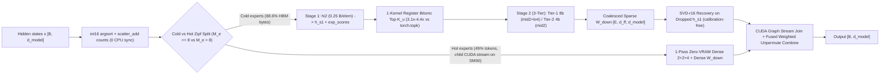

# Architecture Reference (`sparse-moe-mm` `v0.2.0`)

This document consolidates the algorithmic and kernel design of `sparse-moe-mm` across SM89 (Ada/L4/L40S), SM90 (Hopper/H100/H200), and the planned SM100 (Blackwell/B200) path.

---

## 1. End-to-End Execution Pipeline



---

## 2. Bit-Exact Zero-VRAM `2 + 2 + 4` Representation

Every rowwise-scaled signed INT8 weight $q \in [-128, 127]$ of `W_gate` and `W_up` is partitioned across three 128B-cache-line-aligned bitplanes (`block_d_2bit = 512`, `block_d_4bit = 256`) stored in unified `[E, 2 * d_ff, ...]` buffers (`wg_*` and `wu_*` are zero-copy slices):

| Bitplane | Storage | Bytes/elem | Role | Packing Interleave |
|---|---:|---:|---|---|
| `hi2` | `uint8` (`hi2 + 2 in {0..3}`) | `0.25` | Stage-1 coarse gating (`64*(hi2+0.5)`) | `block_d = 512` (128B/row) |
| `mid2` | `uint8` (`{0..3}`) | `0.25` | Tier-2 4-bit refinement (`16*mid2`) | `block_d = 512` (128B/row) |
| `lo4` | `uint8` (`{0..15}`) | `0.50` | Tier-1 bit-exact 8-bit (`lo4 - 32`) | `block_d = 256` (128B/row) |
| **Total `w13`** | — | **`1.00`** | **0.00% duplicate proxy VRAM** | — |

Exact reconstruction identity:
$$q = 64 \cdot (\text{hi2} + 0.5) + 16 \cdot \text{mid2} + \text{lo4} - 32 \in [-128, 127]$$

---

## 3. Architecture-Aware Kernel Dispatch (`sparse_moe_mm/kernels/`)

| Module | Target GPUs | Unpack Primitive | Tensor Core Formulation | Achieved BW / Latency |
|---|---|---|---|---|
| `kernels/sm89.py` | L4, L40S (SM89) | Marlin `0x6000` / `0x6400` FP16 bitcast | `X @ W^T` (`K = 128`, `mma.sync`) | `197 GB/s` S1 (`90%` L4 ceiling), `185 GB/s` S2 (`85%`) |
| `kernels/sm90.py` | H100, H200 (SM90) | **`0x50505050` `lop3.b32` (`pack=4`) -> IEEE `float8_e4m3fn`** | **Transposed `W @ X^T` `WGMMA (M=64, N=8, P=128)`** | **`2,906 GB/s` S1 (`95%` raw read ceiling, 0 spills)**, `2,251 GB/s` S2 |
| `kernels/_common.py` | SM89 & SM90 | Shared `tl.int64`-indexed Down, `SVD-r16`, Combine, Register Bitonic TopK | `BLOCK_D = 128/256` | TopK `8–16 µs` (`3.1×–4.4×` vs `torch.topk`) |
| *Planned `kernels/sm100.py`* | B200 (SM100) | `1×16` NVFP4 + `Gate4` | Hardware TMA `gather4` + PDL | Milestone 2 |

### Why SM90 Uses `0x50505050` `lop3.b32` + Transposed `W @ X^T` (`O11`)
On `4.8 TB/s` H200, `X @ W^T` with `M_e <= 8` padded to `M = 16` forces Hopper to fall back from `WGMMA` (`1,979 TFLOPS` FP8) to `mma.sync` (`~190 TFLOPS`), while scalar bit-unpacking saturates INT32 ALUs around `470 GB/s`.

1. **Linear FP8 mantissa bitcast:** IEEE `float8_e4m3fn` bytes `0x50..0x57` represent exact unit steps `8.0, 9.0, ..., 15.0`. A single `lop3.b32 $0, $1, 0x03030303, 0x50505050, 0xEA` unpacks 4 weights straight into `float8_e4m3fn` with zero K-loop subtraction (constant offset subtracted once via precomputed per-token `x_sum`). Splitting `mid2` + `lo4` into `mid3 = (mid2 << 1) | (lo4 >> 3)` and `lo3 = lo4 & 7` yields bit-exact (`max_abs_err = 0.0`) full 8-bit reconstruction:
   $$q = 64(\text{hi2} + 10) + 8(\text{mid3} + 8) + (\text{lo3} + 8) - 712$$
2. **Transposed `W @ X^T`:** Putting `BLOCK_F = 64` on LHS `M` activates native Hopper `wgmma.mma_async.m64n8k32` with `N = 8` matching `cold_me_thresh = 8`, lifting H200 Stage-1 by `6.29×` (`551.9 µs -> 87.7 µs`).

---

## 4. Module Map

```text
sparse_moe_mm/
├── __init__.py          # Public package exports
├── packing.py           # Prog8MoEConfig, PackedProg8ExpertWeights, pack_hf_fp8_experts (0% dup w13)
├── vllm_plugin.py       # Prog8SparseMoEExperts (FusedMoEExpertsModular), oracle gate, plugin hook
├── reference.py         # Exact FP32/FP8/NVFP4/2+2+4 ground-truth math & bitplane pack/unpack
├── roofline.py          # Analytical HBM + Tensor Core roofline across L4/L40S/H200/B200
└── kernels/
    ├── __init__.py      # Backwards-compatible facade re-exporting all kernels & launchers
    ├── _common.py       # Down projection, SVD-r16, fused weighted combine, register bitonic TopK
    ├── sm89.py          # SM89 (L4/L40S) Marlin FP16 bitcast Stage-1/2/Hot-Dense kernels
    └── sm90.py          # SM90 (H100/H200) O11 0x50505050 LOP3 + W@X^T WGMMA FP8 kernels
```
